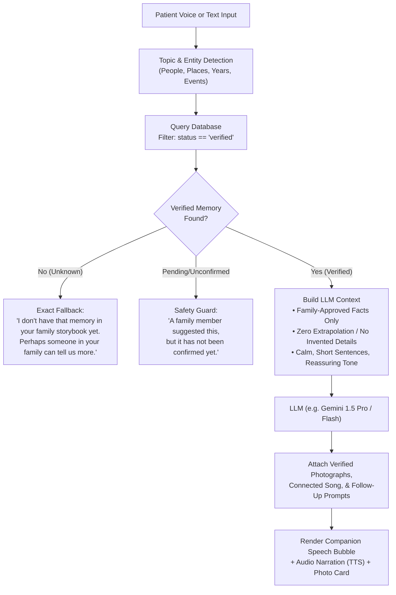

# MemoryBridge — AI Memory Companion for Dementia & Early Alzheimer's Care

MemoryBridge is a warm, supportive, fully interactive personal memory companion for people living with mild cognitive impairment, dementia, or early-stage Alzheimer's, and the families who care for them.

It is **not** a medical, diagnostic, monitoring, or clinical treatment tool. It feels human, warm, and familiar, never like a sterile AI dashboard.

---

## 🌟 Core Principle

> **The AI never invents a person's past.**
> It speaks strictly and solely from family-approved (verified) memories, offers familiar photos and calming music, and openly states when information is not in the family storybook:
> *"I don't have that memory in your family storybook yet. Perhaps someone in your family can tell us more."*

---

## 📐 Architecture & Dual-App Experience

```
                       ┌──────────────────────────────┐
                       │     MemoryBridge Core DB     │
                       │    (localStorage / Cloud)    │
                       └──────────────┬───────────────┘
                                      │
            ┌─────────────────────────┴─────────────────────────┐
            ▼                                                   ▼
┌───────────────────────────────┐               ┌───────────────────────────────┐
│       Caregiver Web App       │               │      Patient Tablet App       │
│        Routes: /family/*      │               │       Routes: /patient/*      │
├───────────────────────────────┤               ├───────────────────────────────┤
│ • Memory Library & Albums     │               │ • 3D Open-Spread Storybooks   │
│ • 4-Step Story Wizard         │               │ • Big Tactile Face Cards      │
│ • Family Verification Queue   │──── Sync ────►│ • Pressure-Free Puzzles       │
│ • Memory Connection Graph     │   (Verified   │ • Vinyl Record Music Player   │
│ • Timeline & Routine Manager  │    Only)      │ • Bedtime Sleepy Mira Diary   │
│ • Relatives & Bio Directory   │               │ • Conversational Companion    │
└───────────────────────────────┘               └───────────────────────────────┘
```

---

## 🤖 Production AI Conversation Architecture



---

## 🔌 Service Layer & Backend Swap Guide

The application is architected with swap-ready TypeScript interfaces under `src/services/index.ts`:

1. **`IMemoryService`**:
   - `getVerifiedMemories(memories)`: Enforces that patient screens only query memories where `status === 'verified'`.
   - Swap: Connect to PostgreSQL / Supabase with Row Level Security (RLS) enforcing `status = 'verified'`.

2. **`IStoryService`**:
   - `generateStoryDraft(input)`: Generates deterministic memory drafts from user-entered titles, dates, locations, and tagged people.
   - Swap: Connect to an LLM endpoint with few-shot prompts instructed to never extrapolate beyond passed fields.

3. **`IConversationService`**:
   - `respond(userText, allMemories, allPeople, patientName)`: Keyword and entity matching engine with strict safety guardrails.
   - Swap: Connect to a LangChain / FastAPI pipeline running Gemini Flash with strict structured outputs.

4. **`ISpeechService`**:
   - Text-to-speech using browser `window.speechSynthesis` with warm rate (0.88x) and pitch controls.
   - Swap: Connect to Google Cloud Text-to-Speech (Journey or Studio voice models) or ElevenLabs.

5. **`IVoiceService`**:
   - Voice speech-to-text using `webkitSpeechRecognition` with graceful fallback to keyboard input.
   - Swap: Connect to Whisper / Google Cloud Speech-to-Text streaming API.

---

## 🎨 Design System & Accessibility

- **Primary Colors**:
  - Main Brand: `#F36B32` (Warm Terracotta Orange)
  - Darker Text-Safe Accent: `#B8431A` (Passes WCAG AAA contrast against light cream)
  - Backgrounds: `#FFFDF9` (Warm White), `#F8F1E8` (Warm Cream), `#FDEEE4` (Peach Wash), `#EBF4F6` (Soft Sky)
- **Typography**:
  - Headings: *Playfair Display* & *Cormorant Garamond* (Editorial, warm serif)
  - Body: *Inter* & *Manrope* (Clean, ultra-legible sans-serif)
- **Dementia-Friendly UX Rules**:
  - 56px+ touch targets on all patient buttons.
  - No countdown timers, no scores, no buzzer sounds, no time pressure.
  - Zero autoplay on audio: music and voice narration start only upon deliberate tap.
  - Text size switcher: Normal (16px+), Large (20px+), Extra Large (24px+).
  - Reduced motion support via `prefers-reduced-motion` in CSS.

---

## 🚀 Running the Prototype Locally

```bash
# 1. Install dependencies
npm install

# 2. Run development server
npm run dev

# 3. Open in browser
http://127.0.0.1:5173/
```

- Navigate to `/` for the Public Landing Page.
- Navigate to `/patient` for the Tablet Companion Experience.
- Navigate to `/family` for the Caregiver Management Hub.
- Edits, new storybooks, and verification approvals persist in `localStorage`.
- Click **"Reset Demo Data"** in Caregiver Settings anytime to restore original state.
