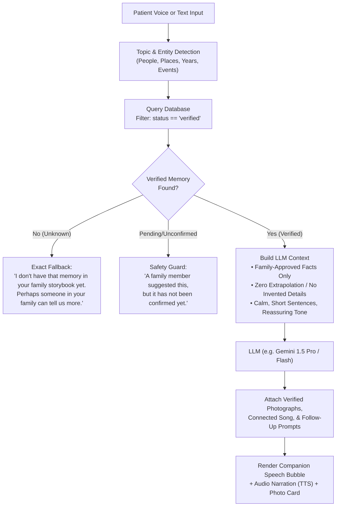

# MemoryBridge — AI Memory Companion for Dementia & Early Alzheimer's Care

MemoryBridge is a warm, supportive, fully interactive personal memory companion for people living with mild cognitive impairment, dementia, or early-stage Alzheimer's, and the families who care for them.

It is **not** a medical, diagnostic, monitoring, or clinical treatment tool. It feels human, warm, and familiar, never like a sterile AI dashboard.

---

## 🌟 Core Principle

> **The AI never invents a person's past.**
> It speaks strictly and solely from family-approved (verified) memories, offers familiar photos and calming music, and openly states when information is not in the family storybook:
> *"I don't have that memory in your family storybook yet. Perhaps someone in your family can tell us more."*

---

## 📐 Architecture & Dual-App Experience

```
                       ┌──────────────────────────────┐
                       │     MemoryBridge Core API    │
                       │  (Express + Prisma/Postgres) │
                       └──────────────┬───────────────┘
                                      │
            ┌─────────────────────────┴─────────────────────────┐
            ▼                                                   ▼
┌───────────────────────────────┐               ┌───────────────────────────────┐
│       Caregiver Web App       │               │      Patient Tablet App       │
│        Routes: /family/*      │               │       Routes: /patient/*      │
├───────────────────────────────┤               ├───────────────────────────────┤
│ • Memory Library & Albums     │               │ • 3D Open-Spread Storybooks   │
│ • 4-Step Story Wizard         │               │ • Big Tactile Face Cards      │
│ • Family Verification Queue   │──── Sync ────►│ • Pressure-Free Puzzles       │
│ • Memory Connection Graph     │   (Verified   │ • Vinyl Record Music Player   │
│ • Timeline & Routine Manager  │    Only)      │ • Bedtime Sleepy Mira Diary   │
│ • Relatives & Bio Directory   │               │ • Conversational Companion    │
└───────────────────────────────┘               └───────────────────────────────┘
```

---

## 🤖 Production AI Conversation Architecture



---

## 🔌 Service Layer & Backend Swap Guide

The application is architected with swap-ready TypeScript interfaces under `src/services/index.ts`:

1. **`IMemoryService`**:
   - `getVerifiedMemories(memories)`: Enforces that patient screens only query memories where `status === 'verified'`.
   - Swap: Connect to PostgreSQL / Supabase with Row Level Security (RLS) enforcing `status = 'verified'`.

2. **`IStoryService`**:
   - `generateStoryDraft(input)`: Generates deterministic memory drafts from user-entered titles, dates, locations, and tagged people.
   - Swap: Connect to an LLM endpoint with few-shot prompts instructed to never extrapolate beyond passed fields.

3. **`IConversationService`** (client-side offline fallback only):
   - `respond(userText, allMemories, allPeople, patientName)`: Keyword and entity matching engine with strict safety guardrails.
   - In the running app the patient companion calls the **backend** companion
     endpoint (verified-memory retrieval + the grounded LLM layer); this local
     engine is used only when the backend is unreachable. See the AI Companion
     section below and `backend/src/services/llm/`.

4. **`ISpeechService`**:
   - Text-to-speech using browser `window.speechSynthesis` with warm rate (0.88x) and pitch controls.
   - Swap: Connect to Google Cloud Text-to-Speech (Journey or Studio voice models) or ElevenLabs.

5. **`IVoiceService`**:
   - Voice speech-to-text using `webkitSpeechRecognition` with graceful fallback to keyboard input.
   - Swap: Connect to Whisper / Google Cloud Speech-to-Text streaming API.

---

## 🎨 Design System & Accessibility

- **Primary Colors**:
  - Main Brand: `#F36B32` (Warm Terracotta Orange)
  - Darker Text-Safe Accent: `#B8431A` (Passes WCAG AAA contrast against light cream)
  - Backgrounds: `#FFFDF9` (Warm White), `#F8F1E8` (Warm Cream), `#FDEEE4` (Peach Wash), `#EBF4F6` (Soft Sky)
- **Typography**:
  - Headings: *Playfair Display* & *Cormorant Garamond* (Editorial, warm serif)
  - Body: *Inter* & *Manrope* (Clean, ultra-legible sans-serif)
- **Dementia-Friendly UX Rules**:
  - 56px+ touch targets on all patient buttons.
  - No countdown timers, no scores, no buzzer sounds, no time pressure.
  - Zero autoplay on audio: music and voice narration start only upon deliberate tap.
  - Text size switcher: Normal (16px+), Large (20px+), Extra Large (24px+).
  - Reduced motion support via `prefers-reduced-motion` in CSS.

---

## 🤖 AI Companion & Verified-Memory Grounding

The companion is **grounded, not generative-by-default**. Every answer is traceable
to a family-verified memory:

1. The patient's question is embedded and matched against **verified memories only**
   (semantic retrieval with a configurable confidence + coverage threshold).
2. If nothing matches, the companion returns the exact safe fallback and **never
   calls an LLM** — so it cannot invent people, places, dates or events.
3. If a verified memory matches, an optional **provider-independent LLM layer**
   (`backend/src/services/llm/`) rephrases *only those retrieved facts* into a warm,
   short reply. A hard grounding guard refuses to generate when there are zero facts.
4. Every response reports its provenance: `answerSource` (`llm` | `rule_based` |
   `fallback`) and the `supportingMemoryId`.

LLM providers are swappable and **keys live on the backend only**:

| `LLM_PROVIDER` | Behaviour |
| --- | --- |
| `none` (default) | Deterministic rule-based replies from verified facts |
| `mock` | Offline deterministic grounded provider (great for CI / no keys) |
| `openai` | OpenAI-compatible Chat Completions (`LLM_API_KEY`, `LLM_MODEL`) |
| `anthropic` | Anthropic Messages API (`LLM_API_KEY`, `LLM_MODEL`) |

Remote calls use `AbortController` timeouts and fall back to the deterministic
grounded reply on any error. See `backend/.env.example` for all options.

## 🚀 Running Locally (Full Stack)

**Backend (Express + Prisma + PostgreSQL):**

```bash
cd backend
cp .env.example .env            # set DATABASE_URL + JWT secrets (see file)
npm install
npx prisma migrate deploy       # apply migrations
npx prisma generate
npm run dev                      # API on http://localhost:4000
```

**Frontend (React + Vite):**

```bash
npm install
npm run dev                      # app on http://127.0.0.1:5173 (proxies /api -> backend)
```

- Navigate to `/` for the Public Landing Page.
- Navigate to `/patient` for the Tablet Companion Experience.
- Navigate to `/family` for the Caregiver Management Hub.
- A signed-in workspace uses the **backend as the source of truth**. Seed content in
  `src/data/mockData.ts` is only a fallback for the signed-out public demo; it is
  never substituted for a failed backend request, and writes that fail are rolled
  back instead of being reported as saved.
- Click **"Reset Demo Data"** in Caregiver Settings to restore the seeded workspace
  in the database.

### Checks

```bash
npm run lint      # frontend lint (oxlint)
npm run build     # frontend type-check + production build
cd backend && npm test   # backend suite (requires a reachable PostgreSQL)
```
