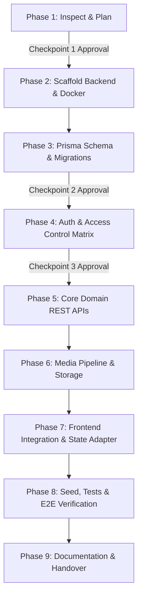

# MemoryBridge Backend Architecture & Implementation Plan
**Version:** 1.0.0  
**Status:** Pending Approval (Phase 1 Checkpoint)  
**Author:** Senior Backend Engineer & Database Architect  

---

## 1. Executive Summary & Objective

**MemoryBridge** is a supportive memory companion application designed for individuals living with mild cognitive impairment, dementia, or early-stage Alzheimer's, and their family caregivers. It is strictly a non-medical, supportive memory curation and grounding tool.

### Objectives
1. Build a robust, modular, secure, and tested RESTful backend using **Node.js, Express, TypeScript (strict mode), PostgreSQL, and Prisma ORM**.
2. Seamlessly connect the existing React 19 frontend to the backend via a type-safe API client and DTO mapping layer without changing any visual styling, layout, user experience, animations, or existing routes.
3. Enforce strict dementia safety boundaries: the patient and companion experience can **only ever access family-verified memories**. Unverified/pending memories remain quarantined in the caregiver management area.
4. Prepare clean extension points for future AI/RAG and voice capabilities while maintaining deterministic rule-based companion safety today.

---

## 2. Confirmed Frontend Inventory & Verification

The existing frontend was thoroughly inspected. Below is the verified inventory:

### 2.1 Tech Stack & Environment
- **Runtime & Bundler:** Vite 8.3.5, React 19.3.1, TypeScript ~7.0.2
- **Styling:** Tailwind CSS 3.4.19 with custom design tokens (`primary: #F36B32`, `warm-wash: #FFFDF9`, `surface-border: #EADBCC`, etc.)
- **Routing:** `react-router-dom` 7.18.5
- **Animation & Visuals:** `framer-motion` 14.9.0, `canvas-confetti` 1.9.4, `lucide-react` 1.66.0
- **Linting:** `oxlint` 1.89.0

### 2.2 Route Architecture
- **Public:**
  - `/` &rarr; `LandingPage` (Hero, feature breakdown, direct launch triggers for Patient and Caregiver modes)
- **Patient Experience (`/patient/*` via `PatientLayout`):**
  - `/patient` &rarr; `PatientHome` (Good morning greeting, quick circular shortcuts, 3D bookshelf for albums)
  - `/patient/memories` &rarr; `PatientMemories` (Album viewer with audio narration, verified memories only)
  - `/patient/family` &rarr; `PatientFamily` (Family member profiles & shared verified memories)
  - `/patient/timeline` &rarr; `PatientTimeline` (Chronological journey by era from 1960 to present)
  - `/patient/music` &rarr; `PatientMusic` (Calming playlist with vinyl aesthetic linked to memories)
  - `/patient/journeys` &rarr; `PatientJourneys` (Interactive map with location pins: Shimla, Delhi, Goa)
  - `/patient/diary` &rarr; `PatientDiary` (Bedtime summary note with weather and caregiver signature)
  - `/patient/calendar` & `/patient/activities` &rarr; `PatientActivities` (Daily routine checklist, jigsaw puzzle, colouring canvas, face matching)
  - `/patient/companion` &rarr; `PatientCompanion` (Mira AI conversational companion with TTS & STT)
- **Caregiver Experience (`/family/*` via `CaregiverLayout`):**
  - `/family` &rarr; `CaregiverOverview` (Quick stats, pending verification count, today's memory, routine)
  - `/family/library` &rarr; `CaregiverLibrary` (Searchable memory bank, album filters, edit/delete modals)
  - `/family/create-storybook` &rarr; `CaregiverCreateStorybook` (4-step memory creation wizard with photo upload, voice input, auto-drafting)
  - `/family/memory/:id` &rarr; `CaregiverMemoryDetail` (Detailed view of individual memory, tagged people, audio player)
  - `/family/people` &rarr; `CaregiverPeople` (Family directory, add/edit person, link relationships)
  - `/family/timeline` &rarr; `CaregiverTimeline` (Vertical interactive life milestone timeline)
  - `/family/connections` &rarr; `CaregiverConnections` (Interactive node graph of people, places, and events)
  - `/family/companion` &rarr; `PatientCompanion` (Caregiver view of conversational assistant)
  - `/family/routine` &rarr; `CaregiverRoutine` (Daily routine items manager: add, remove, categorize)
  - `/family/verification` &rarr; `CaregiverVerification` (Approval/rejection queue for pending & AI drafts)
  - `/family/settings` &rarr; `CaregiverSettings` (Display text size, voice toggle, prototype demo reset)

### 2.3 Existing State & Services
- **State (`src/store/AppContext.tsx`):** LocalStorage-backed reactive state (`memorybridge_store_v1_*`) managing `people`, `memories`, `albums`, `routine`, `songs`, `diary`, `patientName`, `textSize`, `voiceEnabled`, `activeSong`, `isPlayingMusic`, and `toast`.
- **Services (`src/services/index.ts`):**
  - `memoryService`: `getVerifiedMemories`, `searchMemories`, `getMemoriesByPerson`, `getMemoriesByEra`, `getMemoryById`.
  - `storyService`: `generateStoryDraft` (deterministic templates).
  - `conversationService`: Deterministic safety rules for Mira with exact required fallback.
  - `speechService` & `voiceService`: Browser Web Speech API wrappers.
  - `mediaService`: `readFileAsDataUrl` (FileReader).
- **Safety Test Suite (`test-safety.mjs`):**
  1. Verified Goa query &rarr; Returns 1998 Goa memory card.
  2. Pending Nepal query &rarr; Says memory *"hasn't been confirmed yet"*.
  3. Unknown query (Paris) &rarr; Exact required fallback: *"I don't have that memory in your family storybook yet. Perhaps someone in your family can tell us more."*
  4. Wedding query &rarr; Returns verified details ("November 22, 1985", "Anita").

---

## 3. Discrepancy & Conflict Analysis

| # | Topic | Specification in Prompt | Found in Frontend Code | Proposed Resolution |
|---|-------|------------------------|------------------------|---------------------|
| 1 | **Create Storybook Page vs. Model** | Prompt defines a `Storybook` entity with `StorybookMemories` (sequenceOrder), and mentions `CaregiverCreateStorybook`. | In the frontend, `/family/create-storybook` (`CaregiverCreateStorybook.tsx`) is actually a 4-step wizard that creates a `Memory` row into an `Album`. | **Support both**: Include both `Album` and `Storybook` / `StorybookMemories` in the backend schema. Ensure the wizard's output seamlessly creates a `Memory` and links it to an `Album` (and optionally generates a `Storybook` entry), ensuring zero UI breakage while fulfilling all storybook REST endpoints. |
| 2 | **Entity Field Naming & DTOs** | Schema uses `fullName`, `biography`, `profileImage`, `scheduledTime`, `eventDate`/`approximateYear`, `verificationStatus`. | Frontend uses `name`, `bio`, `avatarUrl`, `time`, `year`/`dateStr`, `status` (`'verified' \| 'pending' \| 'ai-suggested'`). | **DTO Mappers in API Client**: Implement bidirectional adapters (`toFrontendMemory`, `toFrontendPerson`, `toFrontendRoutine`, etc.) in `src/api/client.ts`. The UI components will continue to receive the exact properties they currently expect. |
| 3 | **Person Relationships & Derived Counts** | Backend uses separate `Relationship` table and derives `sharedMemoryCount`. | Frontend `Person` has `relationship: string` ("Wife", "Daughter") and numeric `sharedMemoryCount`. | When serving `GET /patients/:patientId/people`, join with `Relationship` to populate the `relationship` string relative to the patient, and compute `sharedMemoryCount = COUNT(MemoryPeople)` for verified memories. |
| 4 | **Patient Authentication & Mode** | Patient has no credentials. Caregiver issues time-limited `PatientSession` token (`typ: "patient"`). | Currently, `/patient` routes are directly accessible without login. | **Frictionless Transition**: Caregivers log in via `/family`. Navigating to `/patient` automatically uses or acquires a session token for the active patient. Anonymous visitors will be provisioned a demo patient session automatically if no caregiver session is active, maintaining zero-login patient tablet UX while enforcing backend security token scope. |
| 5 | **ADMIN Role Isolation** | System administrators must NOT view patient memories. | User roles: `ADMIN`, `CAREGIVER`, `FAMILY_MEMBER`. | Enforce in `requirePatientAccess`: `ADMIN` only grants access to system-level endpoints (`/admin/*`, user management, audit logs). Access to patient memories strictly requires an entry in `PatientAccess`. |
| 6 | **Demo Data Reset** | Reset demo data in `CaregiverSettings.tsx` clears localStorage and reloads mock data. | `resetDemoData()` resets localStorage keys. | In API mode, if `VITE_USE_MOCK=false`, trigger an authorized `POST /patients/:patientId/reset-demo` (restricted to OWNER) to re-seed demo data in the database, with a graceful UI confirmation. |

---

## 4. Stack & Directory Architecture

### 4.1 Backend Stack
- **Language & Runtime:** TypeScript (Strict), Node.js (v20+ LTS recommended)
- **HTTP Framework:** Express 4.x
- **Database & ORM:** PostgreSQL 16 (with `pgvector` enabled where available), Prisma ORM
- **Security & Utilities:** `helmet`, `cors`, `express-rate-limit`, `zod`, `bcrypt` (salt rounds &ge; 12), `jsonwebtoken`, `cookie-parser`, `pino` & `pino-http` (with redaction for passwords, memory text, and tokens)
- **Storage:** Firebase Admin SDK with a modular `StorageProvider` abstraction (pluggable `LocalStorageProvider` / `MockStorageProvider` for local dev/testing without active cloud credentials)
- **Testing:** `vitest`, `supertest`

### 4.2 Repository Directory Structure
```
DEMOPBL/
├── backend/
│   ├── prisma/
│   │   ├── schema.prisma
│   │   ├── migrations/
│   │   └── seed.ts
│   ├── src/
│   │   ├── config/             # Environment, Firebase, logger, constants
│   │   ├── controllers/        # HTTP handlers (req/res, status codes)
│   │   ├── middleware/         # Auth, requirePatientAccess, rateLimit, errorHandler, auditLog
│   │   ├── routes/             # Express routers (/api/v1/...)
│   │   ├── services/           # Business logic, safety rules, storage, retrieval
│   │   │   ├── authService.ts
│   │   │   ├── memoryService.ts
│   │   │   ├── conversationService.ts   # Ported safety logic
│   │   │   ├── verificationService.ts
│   │   │   ├── storage/                 # StorageProvider, Firebase & Local/Mock
│   │   │   └── ai/                      # AiProvider interface & rule-based engine
│   │   ├── repositories/       # Prisma query encapsulation
│   │   ├── validators/         # Zod schemas for request validation
│   │   ├── utils/              # Token helpers, response envelopers, hashing
│   │   ├── types/              # Backend DTOs, Express augmentation, Enums
│   │   ├── app.ts              # Express application configuration
│   │   └── server.ts           # HTTP server bootstrap & graceful shutdown
│   ├── tests/
│   │   ├── unit/
│   │   ├── integration/
│   │   └── fixtures/
│   ├── docker-compose.yml      # PostgreSQL with pgvector
│   ├── .env.example
│   ├── package.json
│   ├── tsconfig.json
│   └── README.md
├── docs/
│   └── backend-plan.md         # This implementation plan
├── src/                        # Existing Frontend
│   ├── api/                    # NEW: client.ts, adapters, mappers
│   └── ...
```

---

## 5. Relational Data Model (Prisma Schema)

### 5.1 Entities and Schema Definitions
All tables use UUID v4 primary keys, timestamps (`createdAt`, `updatedAt`), and soft-deletes (`deletedAt DateTime?`) on user-recoverable resources (`PatientProfile`, `Memory`, `Person`, `Storybook`, `Media`).

```prisma
datasource db {
  provider = "postgresql"
  url      = env("DATABASE_URL")
}

generator client {
  provider = "prisma-client-js"
}

enum UserRole {
  ADMIN
  CAREGIVER
  FAMILY_MEMBER
}

enum AccessRole {
  OWNER
  CAREGIVER
  FAMILY
  VIEWER
}

enum VerificationStatus {
  PENDING
  VERIFIED
  REJECTED
  AI_SUGGESTED
}

enum MemorySource {
  FAMILY_SUBMITTED
  CAREGIVER
  AI_DRAFTED
}

enum MediaType {
  IMAGE
  VIDEO
  AUDIO
}

enum StorybookStatus {
  DRAFT
  PUBLISHED
}

enum RoutinePeriod {
  Morning
  Afternoon
  Evening
}

enum RoutineCategory {
  activity
  meal
  medication
  family_call
  walk
}

enum ReminderStatus {
  Active
  Dismissed
}

enum SenderType {
  USER
  COMPANION
}

enum EmbeddingStatus {
  NONE
  PENDING
  READY
}

model User {
  id            String          @id @default(uuid())
  email         String          @unique
  name          String
  passwordHash  String
  role          UserRole        @default(FAMILY_MEMBER)
  tokenVersion  Int             @default(0)
  createdAt     DateTime        @default(now())
  updatedAt     DateTime        @updatedAt

  patientAccess PatientAccess[]
  createdMemories Memory[]      @relation("MemoryCreator")
  verifiedMemories Verification[]
  createdStorybooks Storybook[]
  patientSessions PatientSession[]
  auditLogs     AuditLog[]
  mediaUploads  Media[]

  @@index([email])
}

model PatientProfile {
  id                String          @id @default(uuid())
  fullName          String
  dateOfBirth       DateTime?
  profileImage      String?
  preferredLanguage String          @default("en")
  biography         String?
  personId          String?         @unique // Link to Person entry for self
  deletedAt         DateTime?
  createdAt         DateTime        @default(now())
  updatedAt         DateTime        @updatedAt

  accessList        PatientAccess[]
  memories          Memory[]
  albums            Album[]
  people            Person[]
  relationships     Relationship[]
  storybooks        Storybook[]
  routineItems      RoutineItem[]
  diaryEntries      DiaryEntry[]
  conversations     Conversation[]
  patientSessions   PatientSession[]
  media             Media[]
  auditLogs         AuditLog[]

  @@index([fullName])
}

model PatientAccess {
  id           String         @id @default(uuid())
  userId       String
  patientId    String
  relationship String         // e.g. "Wife", "Daughter", "Primary Caregiver"
  accessRole   AccessRole     @default(FAMILY)
  createdAt    DateTime       @default(now())
  updatedAt    DateTime       @updatedAt

  user         User           @relation(fields: [userId], references: [id], onDelete: Cascade)
  patient      PatientProfile @relation(fields: [patientId], references: [id], onDelete: Cascade)

  @@unique([userId, patientId])
  @@index([userId])
  @@index([patientId])
}

model Memory {
  id                 String             @id @default(uuid())
  patientId          String
  albumId            String?
  title              String
  description        String?
  story              String
  audioDescription   String?
  eventDate          DateTime?
  approximateYear    Int?
  location           String?
  eventType          String?
  era                String             // Childhood, First School, College, Career, Wedding & Family, Golden Years
  tags               String[]           @default([])
  source             MemorySource       @default(FAMILY_SUBMITTED)
  verificationStatus VerificationStatus @default(PENDING)
  approvedById       String?
  songId             String?
  mapX               Float?
  mapY               Float?
  mapLabel           String?
  contentHash        String?
  embeddingStatus    EmbeddingStatus    @default(NONE)
  // embedding       Unsupported("vector(1536)")?
  deletedAt          DateTime?
  createdBy          String
  createdAt          DateTime           @default(now())
  updatedAt          DateTime           @updatedAt

  patient            PatientProfile     @relation(fields: [patientId], references: [id], onDelete: Cascade)
  album              Album?             @relation(fields: [albumId], references: [id], onDelete: SetNull)
  creator            User               @relation("MemoryCreator", fields: [createdBy], references: [id])
  people             MemoryPeople[]
  media              Media[]
  storybookMemories  StorybookMemories[]
  verifications      Verification[]
  relatedMessages    Message[]

  @@index([patientId])
  @@index([patientId, verificationStatus])
  @@index([albumId])
  @@index([approximateYear])
  @@index([era])
}

model Album {
  id          String         @id @default(uuid())
  patientId   String
  title       String
  coverImage  String?
  colorTheme  String         @default("amber")
  yearRange   String?
  description String?
  createdAt   DateTime       @default(now())
  updatedAt   DateTime       @updatedAt

  patient     PatientProfile @relation(fields: [patientId], references: [id], onDelete: Cascade)
  memories    Memory[]

  @@index([patientId])
}

model Person {
  id                String         @id @default(uuid())
  patientId         String
  fullName          String
  biography         String?
  birthYear         Int?
  profileImage      String?
  confirmedByFamily Boolean        @default(true)
  deletedAt         DateTime?
  createdAt         DateTime       @default(now())
  updatedAt         DateTime       @updatedAt

  patient           PatientProfile @relation(fields: [patientId], references: [id], onDelete: Cascade)
  memories          MemoryPeople[]
  relationshipsAsOne Relationship[] @relation("PersonOne")
  relationshipsAsTwo Relationship[] @relation("PersonTwo")

  @@index([patientId])
}

model Relationship {
  id               String         @id @default(uuid())
  patientId        String
  personOneId      String
  personTwoId      String
  relationshipType String         // e.g. "Spouse", "Parent", "Child", "Friend"
  description      String?
  createdAt        DateTime       @default(now())
  updatedAt        DateTime       @updatedAt

  patient          PatientProfile @relation(fields: [patientId], references: [id], onDelete: Cascade)
  personOne        Person         @relation("PersonOne", fields: [personOneId], references: [id], onDelete: Cascade)
  personTwo        Person         @relation("PersonTwo", fields: [personTwoId], references: [id], onDelete: Cascade)

  @@unique([patientId, personOneId, personTwoId, relationshipType])
  @@index([patientId])
}

model MemoryPeople {
  memoryId  String
  personId  String

  memory    Memory   @relation(fields: [memoryId], references: [id], onDelete: Cascade)
  person    Person   @relation(fields: [personId], references: [id], onDelete: Cascade)

  @@id([memoryId, personId])
  @@index([memoryId])
  @@index([personId])
}

model Storybook {
  id             String              @id @default(uuid())
  patientId      String
  title          String
  description    String?
  coverImage     String?
  generatedStory String?
  status         StorybookStatus     @default(DRAFT)
  createdBy      String
  deletedAt      DateTime?
  createdAt      DateTime            @default(now())
  updatedAt      DateTime            @updatedAt

  patient        PatientProfile      @relation(fields: [patientId], references: [id], onDelete: Cascade)
  creator        User                @relation(fields: [createdBy], references: [id])
  memories       StorybookMemories[]

  @@index([patientId])
}

model StorybookMemories {
  id            String    @id @default(uuid())
  storybookId   String
  memoryId      String
  sequenceOrder Int

  storybook     Storybook @relation(fields: [storybookId], references: [id], onDelete: Cascade)
  memory        Memory    @relation(fields: [memoryId], references: [id], onDelete: Cascade)

  @@unique([storybookId, sequenceOrder])
  @@index([storybookId])
  @@index([memoryId])
}

model Verification {
  id           String             @id @default(uuid())
  memoryId     String
  verifiedById String
  status       VerificationStatus
  comments     String?
  createdAt    DateTime           @default(now())

  memory       Memory             @relation(fields: [memoryId], references: [id], onDelete: Cascade)
  verifier     User               @relation(fields: [verifiedById], references: [id])

  @@index([memoryId])
  @@index([verifiedById])
}

model Media {
  id            String         @id @default(uuid())
  patientId     String
  memoryId      String?
  mediaType     MediaType
  storagePath   String         // Object key in storage bucket
  thumbnailPath String?
  fileName      String
  mimeType      String
  sizeBytes     Int
  caption       String?
  uploadedBy    String
  deletedAt     DateTime?
  createdAt     DateTime       @default(now())
  updatedAt     DateTime       @updatedAt

  patient       PatientProfile @relation(fields: [patientId], references: [id], onDelete: Cascade)
  memory        Memory?        @relation(fields: [memoryId], references: [id], onDelete: SetNull)
  uploader      User           @relation(fields: [uploadedBy], references: [id])

  @@index([patientId])
  @@index([memoryId])
}

model RoutineItem {
  id             String          @id @default(uuid())
  patientId      String
  title          String
  scheduledTime  String          // "08:30 AM"
  period         RoutinePeriod
  category       RoutineCategory
  notes          String?
  completed      Boolean         @default(false)
  reminderStatus ReminderStatus  @default(Active)
  createdBy      String
  createdAt      DateTime        @default(now())
  updatedAt      DateTime        @updatedAt

  patient        PatientProfile  @relation(fields: [patientId], references: [id], onDelete: Cascade)

  @@index([patientId])
}

model DiaryEntry {
  id            String         @id @default(uuid())
  patientId     String
  date          DateTime
  weather       String
  greeting      String
  morningNote   String
  afternoonNote String
  eveningNote   String
  caregiverSign String
  createdAt     DateTime       @default(now())
  updatedAt     DateTime       @updatedAt

  patient       PatientProfile @relation(fields: [patientId], references: [id], onDelete: Cascade)

  @@unique([patientId, date])
  @@index([patientId])
}

model Conversation {
  id               String          @id @default(uuid())
  patientId        String
  userId           String?
  patientSessionId String?
  createdAt        DateTime        @default(now())

  patient          PatientProfile  @relation(fields: [patientId], references: [id], onDelete: Cascade)
  messages         Message[]

  @@index([patientId])
}

model Message {
  id              String       @id @default(uuid())
  conversationId  String
  senderType      SenderType
  messageText     String
  relatedMemoryId String?
  createdAt       DateTime     @default(now())

  conversation    Conversation @relation(fields: [conversationId], references: [id], onDelete: Cascade)
  relatedMemory   Memory?      @relation(fields: [relatedMemoryId], references: [id], onDelete: SetNull)

  @@index([conversationId])
}

model PatientSession {
  id        String         @id @default(uuid())
  patientId String
  createdBy String
  expiresAt DateTime
  revokedAt DateTime?
  createdAt DateTime       @default(now())

  patient   PatientProfile @relation(fields: [patientId], references: [id], onDelete: Cascade)
  creator   User           @relation(fields: [createdBy], references: [id])

  @@index([patientId])
  @@index([expiresAt])
}

model AuditLog {
  id           String         @id @default(uuid())
  actorId      String?
  patientId    String
  action       String         // e.g., "VERIFY_MEMORY", "DELETE_PERSON", "MEDIA_READ"
  resourceType String         // "Memory", "Media", "PatientAccess"
  resourceId   String
  metadata     Json?
  createdAt    DateTime       @default(now())

  patient      PatientProfile @relation(fields: [patientId], references: [id], onDelete: Cascade)
  actor        User?          @relation(fields: [actorId], references: [id], onDelete: SetNull)

  @@index([patientId])
  @@index([actorId])
  @@index([createdAt])
}
```

---

## 6. Access Control & Patient Permissions Matrix

### 6.1 Role Hierarchy & Capabilities

| Capability | OWNER | CAREGIVER | FAMILY | VIEWER | Patient Token (`typ: "patient"`) | System ADMIN |
|---|:---:|:---:|:---:|:---:|:---:|:---:|
| Read Verified Memories, People, Routine, Albums, Diary | Yes | Yes | Yes | Yes | **Yes** (Strictly verified only) | No (Admin only) |
| Read PENDING / AI_SUGGESTED / REJECTED | Yes | Yes | Own submissions only | No | **No** (Denied / 404) | No |
| Create Memory / Media / Person | Yes | Yes | Yes (Memories start as PENDING) | No | No | No |
| Verify / Reject Memories | Yes | Yes | No | No | No | No |
| Edit / Reorder Storybooks & Routine | Yes | Yes | No | No | No | No |
| Toggle Routine Completion | Yes | Yes | Yes | No | **Yes** | No |
| Create Mira Messages (Companion) | Yes | Yes | Yes | Yes | **Yes** | No |
| Issue / Revoke Patient Sessions | Yes | Yes | No | No | No | No |
| Manage Patient Access (Invite/Remove) | Yes | No | No | No | No | No |
| Soft Delete Patient Profile | Yes | No | No | No | No | No |

### 6.2 Key Security Middleware Design
1. **`authenticate`**: Verifies JWT from `Authorization: Bearer <token>`. Checks `tokenVersion` against the database to guarantee instant revocation on logout.
2. **`requirePatientAccess(minRole | permission)`**: 
   - Resolves target `patientId` either directly from params (`:patientId`) or from the resource repository lookup (`:id` of memory, media, storybook, routine, etc.).
   - Evaluates `PatientAccess` record for `(req.user.id, targetPatientId)`.
   - Returns **`404 Not Found`** instead of `403 Forbidden` if the caller has no permission, preventing resource enumeration across patient boundaries.
3. **`authenticatePatientSession`**:
   - Validates patient-scoped tokens (`typ: "patient"`). Checks expiration and ensures `revokedAt == null`.
   - Constrains all database queries to `patientId` and enforces `verificationStatus == 'VERIFIED'`.

---

## 7. REST API Endpoints Specification (`/api/v1`)

All responses adhere to a consistent JSON envelope:
```json
{
  "data": { ... },
  "error": null
}
```
Errors return standard RFC-compliant HTTP status codes with an error envelope:
```json
{
  "data": null,
  "error": {
    "code": "RESOURCE_NOT_FOUND",
    "message": "The requested memory does not exist"
  }
}
```

### 7.1 Authentication & Profile
- `POST /api/v1/auth/register` &rarr; Register user (Zod: email, password [min 8 chars], name).
- `POST /api/v1/auth/login` &rarr; Login (Rate-limited, lockout on 5 failures; sets HttpOnly refresh token cookie, returns access token).
- `POST /api/v1/auth/logout` &rarr; Increments `tokenVersion`, clears cookie.
- `POST /api/v1/auth/refresh` &rarr; Rotates refresh token, issues new access token.
- `GET /api/v1/auth/me` &rarr; Current user profile and patient access list.

### 7.2 Patient Profile & Sessions
- `GET /api/v1/patients` &rarr; List patients accessible to current user.
- `POST /api/v1/patients` &rarr; Create new patient profile (assigns creator as `OWNER`).
- `GET /api/v1/patients/:patientId` &rarr; Get patient profile summary.
- `PATCH /api/v1/patients/:patientId` &rarr; Update profile details (`OWNER` or `CAREGIVER`).
- `DELETE /api/v1/patients/:patientId` &rarr; Soft-delete patient profile (`OWNER` only).
- `POST /api/v1/patients/:patientId/patient-sessions` &rarr; Generate patient tablet token (`OWNER` / `CAREGIVER`).
- `GET /api/v1/patients/:patientId/patient-sessions` &rarr; List active patient sessions.
- `DELETE /api/v1/patient-sessions/:id` &rarr; Revoke patient session.

### 7.3 Memories & Verification
- `GET /api/v1/patients/:patientId/memories` &rarr; Paginated list (filtered by status according to caller role).
- `GET /api/v1/patients/:patientId/memories/search` &rarr; Search filters (`q`, `year`, `era`, `location`, `eventType`, `personId`, `status`).
- `POST /api/v1/patients/:patientId/memories` &rarr; Create memory (Zod validated; `PENDING` unless `OWNER`/`CAREGIVER` auto-approves).
- `GET /api/v1/memories/:id` &rarr; Get memory detail with tagged people, media, and signed URLs.
- `PATCH /api/v1/memories/:id` &rarr; Update memory metadata/story (`OWNER`/`CAREGIVER`).
- `DELETE /api/v1/memories/:id` &rarr; Soft delete memory.
- `POST /api/v1/memories/:id/verify` &rarr; Transactionally set status to `VERIFIED` and append `Verification` row (`OWNER`/`CAREGIVER`).
- `POST /api/v1/memories/:id/reject` &rarr; Transactionally set status to `REJECTED` and append `Verification` row (`OWNER`/`CAREGIVER`).
- `GET /api/v1/patients/:patientId/verifications` &rarr; Verification audit trail.

### 7.4 People, Relationships & Connections Graph
- `GET /api/v1/patients/:patientId/people` &rarr; List family & friends with derived `sharedMemoryCount`.
- `POST /api/v1/patients/:patientId/people` &rarr; Add person to family circle.
- `PATCH /api/v1/people/:id` &rarr; Update person details.
- `DELETE /api/v1/people/:id` &rarr; Soft delete person.
- `GET /api/v1/patients/:patientId/relationships` &rarr; List relationships between people.
- `POST /api/v1/patients/:patientId/relationships` &rarr; Create or update relationship.
- `GET /api/v1/patients/:patientId/graph` &rarr; Aggregated nodes (patient, family, events, places) and links for `CaregiverConnections`.

### 7.5 Albums, Storybooks, Routine & Diary
- `GET /api/v1/patients/:patientId/albums` & `POST /api/v1/patients/:patientId/albums` &rarr; Manage albums.
- `PUT /api/v1/albums/:id` & `DELETE /api/v1/albums/:id` &rarr; Edit/delete album.
- `GET /api/v1/patients/:patientId/storybooks` & `POST /api/v1/patients/:patientId/storybooks` &rarr; Storybook CRUD.
- `POST /api/v1/storybooks/:id/memories` &rarr; Set/reorder storybook memories sequence.
- `GET /api/v1/patients/:patientId/routine` & `POST /api/v1/patients/:patientId/routine` &rarr; Routine items.
- `PATCH /api/v1/routine/:id/complete` &rarr; Toggle item completion (Accessible by patient token).
- `DELETE /api/v1/routine/:id` &rarr; Remove routine item.
- `GET /api/v1/patients/:patientId/diary` & `PUT /api/v1/patients/:patientId/diary` &rarr; Daily diary entries by date.

### 7.6 Media & Secure Upload Pipeline
- `POST /api/v1/patients/:patientId/media/upload-url` &rarr; Validate MIME & size, generate unique storage path, return signed v4 upload URL.
- `POST /api/v1/patients/:patientId/media/confirm` &rarr; Verify object existence and metadata in storage, insert `Media` row.
- `GET /api/v1/memories/:memoryId/media` &rarr; Issue temporary (15 min) signed read URLs.
- `DELETE /api/v1/media/:id` &rarr; Soft delete media record and remove storage object.

### 7.7 Companion & Health
- `POST /api/v1/patients/:patientId/conversations` &rarr; Start/retrieve conversation session.
- `POST /api/v1/conversations/:id/messages` &rarr; Send user message & receive companion response (evaluates safety rules).
- `GET /api/v1/health` &rarr; Unauthenticated health check returning database status and timestamp.

---

## 8. Media Architecture & Storage Provider

### 8.1 Provider Abstraction
To ensure full testability and development capability without requiring immediate cloud credentials:
```typescript
export interface StorageProvider {
  generateUploadUrl(path: string, contentType: string, expiresInSec: number): Promise<string>;
  generateReadUrl(path: string, expiresInSec: number): Promise<string>;
  verifyObjectExists(path: string): Promise<{ exists: boolean; sizeBytes?: number; contentType?: string }>;
  deleteObject(path: string): Promise<void>;
}
```
Implementations:
- `FirebaseStorageProvider`: Uses `@google-cloud/storage` under Firebase Admin SDK with bucket v4 signed URLs.
- `LocalStorageProvider` / `MockStorageProvider`: Stores blobs locally in `backend/uploads/` with signed HMAC tokens for dev & automated Vitest runs.

### 8.2 Security Guardrails
- **MIME Allowlist:**
  - Images: `image/jpeg`, `image/png`, `image/webp` (Max 10 MB)
  - Audio: `audio/mpeg`, `audio/mp4`, `audio/wav` (Max 25 MB)
  - Video: `video/mp4`, `video/webm` (Max 200 MB)
- **Object Path Format:** `patients/{patientId}/{uuid}.{ext}` (No client-chosen filenames in storage keys).
- **Client Access:** Firebase Storage bucket rules disallow public reads (`allow read, write: if false;`). All reads must use backend-issued time-limited signed URLs.

---

## 9. Mira Companion & Safety Architecture

### 9.1 Ported Safety Logic
The backend ports the exact deterministic safety logic from `src/services/index.ts` to `backend/src/services/conversationService.ts`:
1. **Scope Enforcement:** Patient ID is extracted exclusively from the validated JWT / Patient Session token.
2. **Pending Memory Quarantine:** If a query contains distinct keywords matching a `PENDING` or `AI_SUGGESTED` memory:
   > *"A family member has suggested a memory about \"{title}\", but it hasn't been confirmed yet by your family. Would you like to explore one of your verified memories instead?"*
3. **Exact Fallback for Unknown Topics:** If no verified memory or curated prompt matches:
   > *"I don't have that memory in your family storybook yet. Perhaps someone in your family can tell us more."*
4. **Verified Memory Cards:** Return the memory card alongside warm text only when `verificationStatus === 'VERIFIED'`.

### 9.2 AI Readiness
- Interface `AiProvider` with `generateResponse(query, context)`:
  - Default: `RuleBasedAiProvider` (shipping now).
  - Stubbed config: `AI_PROVIDER=none|rule_based`.
- Memory content hash (`SHA-256`) and `embeddingStatus` (`NONE`, `PENDING`, `READY`) in schema.
- Optional raw SQL migration for pgvector extension without breaking if unsupported in the host environment.

---

## 10. Frontend Integration Strategy (Zero UI Disruption)

### 10.1 API Client (`src/api/client.ts`)
- Configured with `VITE_API_URL` (defaulting to `/api/v1` via Vite dev proxy).
- Handles credentials (`credentials: 'include'`), Authorization headers, and automatic token refresh on `401`.
- Provides a clean fallback switch: `VITE_USE_MOCK=true` keeps existing localStorage mock logic active; `false` calls the backend.

### 10.2 Transparent DTO Mapping
- Map backend `Memory` to frontend `Memory` (e.g. converting `verificationStatus: 'VERIFIED'` to `'verified'`, deriving `year` and `dateStr` from `approximateYear` and `eventDate`).
- Map backend `Person` to frontend `Person` (deriving `relationship` string from `Relationship` table, and `sharedMemoryCount` from junction count).
- Map backend `RoutineItem` to frontend `RoutineItem` (`scheduledTime` &rarr; `time`).

### 10.3 AppContext Integration
- `AppContext.tsx` will load data asynchronously from the API on mount when `VITE_USE_MOCK !== 'true'`, while exposing the identical `useApp()` hook API.
- Optimistic UI updates for routine toggle, memory additions, and approvals.

### 10.4 Authentication UI
- Discreet caregiver login/register modal or screen matching the exact warm peach and serif styling (`bg-[#FFFDF9]`, `border-[#EADBCC]`, `text-[#292521]`, `primary: #F36B32`).
- Patient experience (`/patient`) remains one-click and seamless.

---

## 11. Seed Data Specifications

The seed will mirror `src/data/mockData.ts` exactly:
- **Patient:** Rajiv Sharma (Born 1957 in Shimla).
- **Users:**
  - Caregiver Owner: `anita@example.com` / `Password123!` (Role: `CAREGIVER`, Access: `OWNER`).
  - Family Member: `riya@example.com` / `Password123!` (Role: `FAMILY_MEMBER`, Access: `FAMILY`).
- **People:** Rajiv (Self), Anita (Wife), Riya (Daughter), Suresh (Lifelong Friend), Daniel (Grandson).
- **Albums:** Childhood & Growing Up, College & Friendships, My Wedding, Family Trips & Journeys, Festivals & Celebrations, Grandson Daniel.
- **Memories:**
  - Verified: 1960 Shimla bicycle, 1966 School, 1978 Graduation with Suresh, 1985 Wedding with Anita, 1988 Bridge Project, 1998 Goa Beach Picnic, 2001 Diwali, 2019 Tulip Field with Daniel.
  - Pending: 1994 Trip to Kathmandu (Nepal).
  - AI Suggested: 1975 Rajiv's Acoustic Guitar.
- **Routine Items:** 6 initial routine items matching `INITIAL_ROUTINE`.
- **Diary:** November 1, 2026 entry matching `INITIAL_DIARY`.

---

## 12. Test Suite & End-to-End Acceptance Plan

### 12.1 Automated Tests (Vitest + Supertest)
1. **Auth & Tokens:** Registration, login, invalid credentials (generic message), rate limiting, token refresh, logout tokenVersion revocation.
2. **Access Control & Tenant Isolation:** User A attempting to access Patient B's memories/media/people receives 404.
3. **Role Enforcement:** `FAMILY` user cannot verify memories; `VIEWER` cannot create; `ADMIN` cannot access patient memories without patient access.
4. **Memory Lifecycle:** CRUD, search filters (`q`, `year`, `era`, `status`), transactional verification status updates with append-only audit trail.
5. **Storage Pipeline:** Mock storage provider upload URL generation, MIME validation, confirm check, signed read URL generation.
6. **Safety Rules:** Complete reproduction of `test-safety.mjs` verifying Goa, pending Nepal, unknown Paris fallback, and wedding queries.
7. **Patient Mode Scope:** Patient token cannot read `PENDING` memories or call caregiver endpoints.

### 12.2 Browser E2E Acceptance Flow (Section 13)
1. Register/Login as Caregiver (`anita@example.com`).
2. Add a new Person to Rajiv's family circle.
3. Submit a new memory with photo upload (starts as `PENDING`).
4. Switch to Patient Mode: Confirm memory does **not** appear in patient album or timeline.
5. In Caregiver Verification Queue: Verify the memory.
6. Switch back to Patient Mode: Confirm memory appears immediately in album and timeline.
7. In Patient Companion (Mira): Query about the newly verified memory &rarr; Mira answers with memory card.
8. Query an unknown topic &rarr; Mira responds with exact fallback: *"I don't have that memory in your family storybook yet. Perhaps someone in your family can tell us more."*

---

## 13. Phase-by-Phase Roadmap & Review Checkpoints



- [x] **Phase 1: Inspect & Plan** &rarr; Complete
- [x] **Phase 2: Scaffold** &rarr; Express, TypeScript, Docker Compose (Postgres), Prisma setup, `/health` endpoint.
- [x] **Phase 3: Schema & Migrations** &rarr; Database migration and initial seed.
- [x] **Phase 4: Auth & Access Control** &rarr; JWT, bcrypt, rate limiter, `requirePatientAccess`, tests passing.
- [x] **Phase 5: Core Domain APIs** &rarr; Memories, People, Relationships, Graph, Albums, Storybooks, Routine, Diary, Mira safety conversation.
- [x] **Phase 6: Media Pipeline** &rarr; Upload URL, confirm, signed URLs, StorageProvider (mock & Firebase).
- [ ] **Phase 7: Frontend Integration** &rarr; `src/api/client.ts`, DTO adapters, AppContext integration, optional auth modal.
- [ ] **Phase 8: Tests & E2E Run** &rarr; Full Vitest suite & browser E2E acceptance verification.
- [ ] **Phase 9: Final Documentation** &rarr; `backend/README.md`, `.env.example`, final report.

