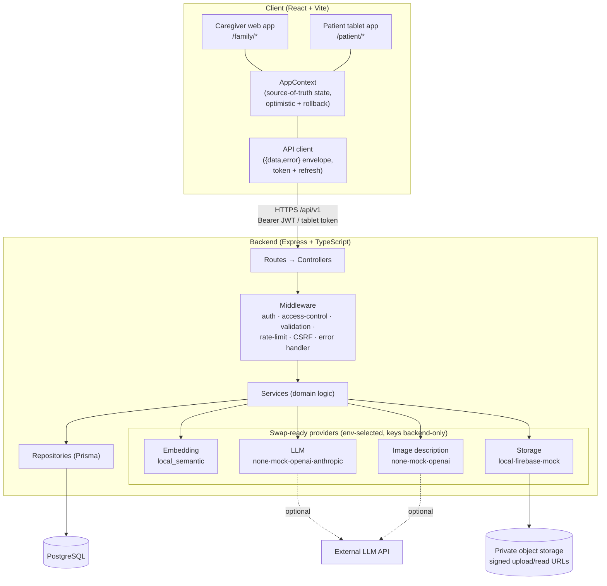
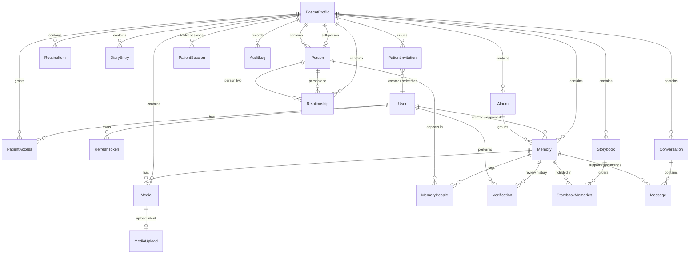
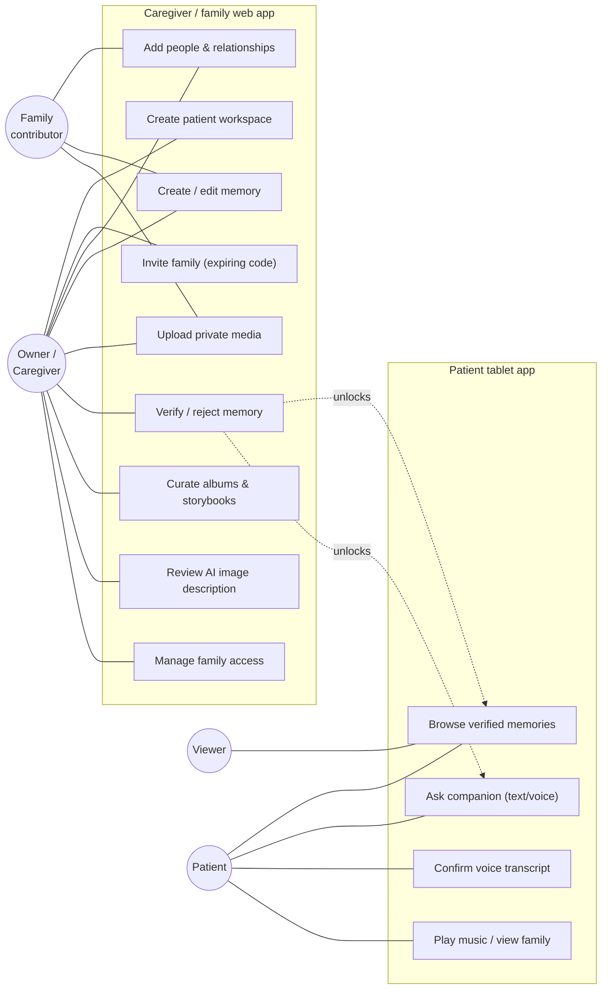

# MemoryBridge — Design Diagrams

System architecture, entity-relationship model, use cases, and the companion
data flow. Diagrams use Mermaid (rendered by GitHub).

## 1. System architecture



**Layering**: Routes → Controllers → Services → Repositories (Prisma). Every
personal fact crosses the verification gate in the service layer; the client
cannot override it. Providers are interfaces chosen at runtime by environment
variables, so the system runs fully offline (mock/local) or against external
services without code changes.

## 2. Entity-relationship diagram



Key integrity rules enforced in schema + services:
- A `Memory` starts `PENDING`; `verificationStatus` gates all patient/viewer reads.
- `Media.aiDescription*` (AI-suggested) is stored apart from `Media.caption`
  (family text) and is not patient-visible until approved.
- `Message.relatedMemoryId` + `retrievalScore` make each companion answer traceable.
- `Relationship` is unique on `(patient, personOne, personTwo, type)`.

## 3. Use-case diagram



The verification use case (u6) is the hinge: only after a caregiver verifies does
content become visible to the patient (p1) and available to the companion (p2).

## 4. Companion recall — data flow

```mermaid
sequenceDiagram
    participant P as Patient (tablet)
    participant API as API /companion/message
    participant EMB as Embedding retrieval
    participant DB as PostgreSQL
    participant LLM as LLM provider (optional)

    P->>API: question (text or confirmed transcript)
    API->>EMB: embed(question)
    EMB->>DB: SELECT memories WHERE status = VERIFIED
    DB-->>EMB: verified memories only
    EMB-->>API: top matches ≥ threshold & coverage (or none)
    alt no match
        API-->>P: exact safe fallback (LLM NOT called)
    else verified match
        API->>LLM: rephrase ONLY these facts (timeout; grounded prompt)
        LLM-->>API: warm phrasing (or error → deterministic reply)
        API->>DB: save turn (relatedMemoryId, retrievalScore)
        API-->>P: answer + memory card + provenance
    end
```

This is the core guarantee in one picture: pending memories never enter
retrieval, and the LLM is invoked only when verified facts exist — so it can
phrase but never invent.
